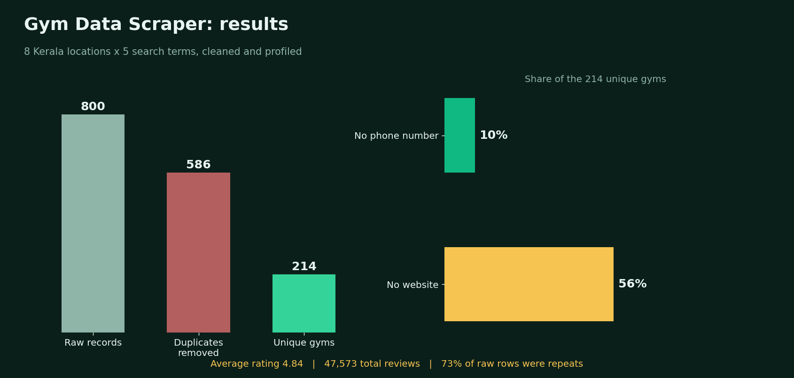

# Gym Listings Scraper and Data Quality Profile

A Python web scraper that collects gym listings across Kerala, then removes duplicates and profiles the data quality.

## Overview

The scraper searches **8 Kerala locations** with **5 search terms** and collects **800 records**. Overlapping searches create many repeats, so the project deduplicates the data and profiles what is left.

Locations: Kochi, Kozhikode, Malappuram, Thiruvananthapuram, Kollam, Kannur, Ernakulam, Thrissur.

## What it does

1. Runs the search terms across each location automatically
2. Captures these fields per record: gym name, phone, address, website, rating, review count, search location and search term
3. Removes duplicate listings
4. Profiles data quality

## Results

| Metric | Value |
|---|---|
| Records scraped | 800 |
| Duplicate listings removed | 586 (73% of the raw data) |
| Unique gyms | **214** |
| Gyms with no website | 56% |
| Gyms with no phone number | 10% |
| Average rating | 4.84 |
| Total reviews | 47,573 |

Why so many duplicates: overlapping searches returned the same gym more than once, so 586 of the 800 rows were repeats.

## Tech stack

Python, web scraping, Pandas.

## Author

**Romy Avril Augustine**, Data Analyst, Kochi, India. 9 years of professional experience (since 2017) across finance operations and, now, analytics.
[LinkedIn](https://www.linkedin.com/in/romyavril/) | [Portfolio](https://romyavril96.github.io/Romy_Portfolio/) | avrilaugustine1996@gmail.com
